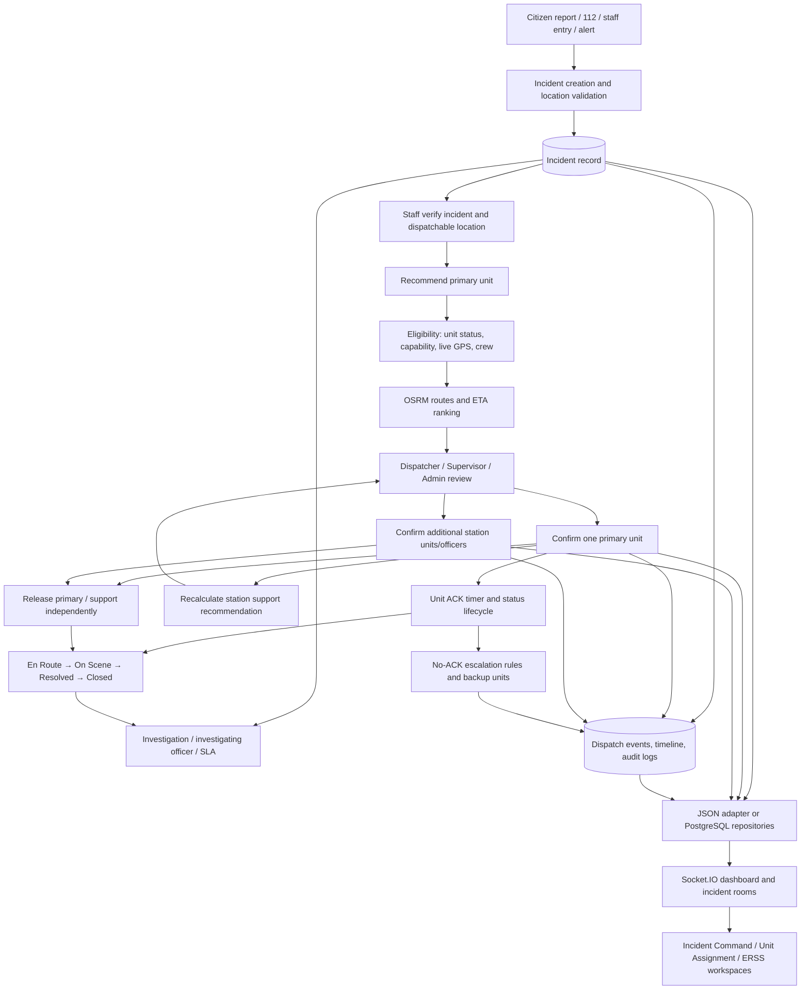

# RakshakAI Emergency Dispatch Architecture Audit

**Mode:** Read-only source and existing-report inspection  
**Workspace:** Local worktree, including its current uncommitted changes  
**Audit date:** 2026-11-17  
**Tests executed for this audit:** None. The request specifies strict read-only inspection; test execution was unnecessary. Test coverage below is based on source inspection and prior repository reports, which are identified as historical evidence.

## 1. Executive summary

RakshakAI already has a substantial emergency dispatch workflow: verified-location gating, unit eligibility and live GPS checks, OSRM-backed route/ETA ranking, operator-confirmed primary assignment, acknowledgement timeout escalation, cross-station hybrid support recommendations, officer deployments tied to a primary unit, independent support and primary release paths, lifecycle/audit records, and PostgreSQL repositories/migrations. It does not need a ground-up dispatch rebuild.

The PTC–Lingampally example is technically dispatchable across stations when the closest eligible unit wins the route ranking. The incident record does not, however, establish PTC as a durable owning station, nor is there a distinct cross-station mutual-aid approval/acceptance protocol. Hybrid support has an explicit operator recommendation and confirmation path after a primary unit exists. Geography alone is not the code’s access check: current incident APIs and the socket room gate broadly allow any authenticated Police Officer to read/join an existing incident, while other surfaces scope by station/jurisdiction or evidence links.

The Gachibowli already-on-scene officer cannot be independently attached through an “Already On Scene” workflow. Officer deployments require active membership in the assigned primary response unit; station support can allocate officers through its hybrid workflow, but does not verify an officer’s physical presence or provide a self-requested incident-access process.

Key confirmed gaps: no canonical incident owning-station field on manual incident creation; unresolved police visibility and cross-station authorization policy; no direct on-scene independent officer deployment; candidate count is not three (the full eligible ranked set is returned and UI caps display at five); and status closure permissions are inconsistent. PostgreSQL serializes dispatch assignment operations through an advisory lock and has a partial unique index for active officer deployments, but response-unit exclusivity is not protected by a database unique constraint. JSON-mode locks are process-local.

## 2. Current architecture

This diagram shows the current logical flow; ERSS-112 has its own event, dispatch-request, unit-request, assistance-request and ownership-transfer records in `backend/services/erss.service.js` and `backend/routes/erss.routes.js`. Those workflows should not be confused with the incident hybrid-support model.

## 3. End-to-end incident lifecycle

1. `createIncidentRecord` in `backend/services/core.service.js` creates a manual or system incident with status `New`, `Verified`, or `Verification Required` depending on input and location. It stores coordinates/location source, severity, response requirements and SLA deadlines, and writes initial timeline, dispatch event and audit records. Manual incident creation does not set an owning station field.
2. Staff can confirm/edit incident location. Dispatch requires a valid location accepted by `dispatchLocationError`; automatic assignment additionally expects `Verified` or `Assigned` status.
3. `POST /api/incidents/:id/recommend-unit` returns an operator-reviewed hybrid recommendation. `POST /api/incidents/:id/assign-unit` confirms the primary selection (or confirms a previously generated support recommendation). A legacy `POST /api/incidents/:id/assign-nearest` both selects and immediately assigns.
4. Primary assignment marks the unit busy, attaches the unit ID to the incident, records route/ETA and starts acknowledgement tracking. ACK sets `primaryUnitAckedAt` and resolves the no-ACK escalation state.
5. Status transitions are constrained by `INCIDENT_TRANSITIONS`: New → Verification Required/Verified; Verified → Assigned; Assigned → En Route; En Route → On Scene; On Scene → Resolved; Resolved → Closed. False-alarm rejection is an alternate terminal path. Confirmed resources are required for Assigned/En Route/On Scene.
6. No-ACK sweeps select backup unit(s) from capability escalation rules, set them busy on the incident, and append dispatch/audit/escalation-log records.
7. Primary unit, hybrid support, and individual officer assignments have distinct release paths. Resolution releases hybrid dispatch resources; closure requires no active primary-unit officer deployment.
8. Investigation fields and SLA monitoring are separate incident properties. Dispatch release and incident status are not modeled as a distinct emergency-response-completed sub-lifecycle, although the DB has an `emergency_response_completed_at` field in the base/Phase 4 schema history.

Primary evidence: `backend/services/core.service.js` (`createIncidentRecord`, `assignNearestIncident`, `assignSelectedIncidentUnit`, `confirmHybridDispatch`, `checkAndTriggerEscalation`, `releaseIncidentSupport`, `releaseAssignedIncidentUnit`, `canTransitionIncident`, status handler); `backend/routes/incidents.routes.js`; `backend/repositories/incidents.repository.js`; `backend/database/migrations/003_phase2_escalation_capabilities.sql`, `007_hybrid_rapid_dispatch.sql`, `008_incident_sla_escalation_investigation.sql`.

## 4. Station ownership versus response

`response_units.station_id` and police officer station membership are modeled. Station/beat/jurisdiction enter candidate ranking and station capacity analysis. Hybrid support allocations record `stationId`, station code/name, officer IDs and unit IDs. ERSS has a separate `jurisdiction_history` and ownership-transfer workflow.

Regular incidents do not have a first-class `owning_station_id`/case owner on creation. Although `incidentForResponse` preserves incidental fields and migrations store incident JSON, `createIncidentRecord` constructs its own record and does not set `stationId`, `policeStationId`, or equivalent. The assigned primary unit’s station is therefore not a reliable substitute for case ownership. The dedicated investigating officer is separately persisted, but not a station owner.

Primary unit selection considers units across the registry, not just the incident’s owning station. `getStationEligibility` computes station/beat/jurisdiction matches for scoring. Those matches are preference/tie-break inputs rather than a hard dispatch-access authorization. Hybrid station support similarly searches all operational stations with coordinates and deployable capacity. It is confirmed by a dispatcher/supervisor/Admin role, but does not implement a request/accept/decline workflow with source-station approval. Do not treat these technical capabilities as a settled agency mutual-aid policy.

## 5. Unit assignment versus individual officer assignment

**Response unit:** The incident stores a single `assignedUnitId` (primary); each unit also stores `assignedIncidentId` / `currentIncidentId`. Confirmed hybrid allocations can add more unit IDs and officer IDs, each attributed to a station. No normalized incident-to-many-response-units assignment table was found; support allocation is JSON on the incident and station metadata is also in the recommendation.

**Individual officer:** `incident_officer_assignments` records officer, incident, the primary unit, role, status and assign/release actors/timestamps. `incidentOfficerAssignment.service.js` only permits active members of the assigned primary unit, requires active Police account/profile, on-duty and available status, and rejects prior active deployment or an emergency-support commitment. Support officers are represented separately by `police_officers.assigned_incident_id` and `supportAllocations`, not the primary-unit deployment table.

No API or frontend control was found for an officer to declare “Already On Scene” and independently request incident assignment/access. `POST /api/incidents/:id/officer-assignments` requires Admin or Police with operational role `DISPATCHER`/`SUPERVISOR`; the individual must be a member of the assigned primary unit. The hybrid station support workflow is the only identified route to reserve a non-primary-unit station officer.

## 6. Nearest-unit recommendation algorithm

`dispatchEligibilitySnapshot` and `bestRoutedUnit` in `backend/services/core.service.js`:

- Considers operational police response units in `available` state; prefers real registry units over demo units when real units are available.
- Excludes committed units, units without an eligible responder, units with missing/stale location, untrusted location source, or accuracy above the telemetry limit; excludes missing required capabilities and reports exclusion reasons.
- Primary hybrid recommendations require authenticated `live_gps`, fresh within two minutes, latest observation within five minutes, timestamp skew bounded, and accuracy ≤100m (`backend/services/unitTelemetry.service.js`). Legacy/manual paths use a less strict freshness/override policy.
- Calculates route for candidate units and sorts primarily by ETA, then road distance, station/beat/jurisdiction rank, capability match, load score, location-source priority, and stable unit code. `hybridDispatch.service.js`’s comparator specifies the tie-break sequence.
- Uses OSRM routing configuration from `backend/services/routingConfig.service.js`; public OSRM is disallowed in production, and self-hosted routing requires `OSRM_BASE_URL`. The route normalizer validates road geometry, waypoint snaps and alternate routes. Approximate Haversine fallback is visibly marked and has no ETA when route duration is unavailable.
- Recommendation results are not a three-unit list: the backend returns the ranked eligible candidate set; the frontend Incident Command/Unit Assignment candidate list shows up to five. The `.slice(0,3)` behavior applies to OSRM route alternatives, not responder count. Existing production gap report independently records this distinction.
- Manual selected-unit assignment recalculates the route but may allow a stale-location override after operator confirmation. Legacy assign-nearest requires routeable candidate data and immediately assigns the best result.

## 7. Hybrid and multi-station response

After primary assignment, `buildHybridDispatchRecommendation` computes severity-sensitive requirements, primary unit/crew and support needs. `recommendStationSupport` scans stations, checks station capacity, officer account/profile/duty/availability and unit status/capability, estimates route from station coordinates, and allocates from the nearest capable stations until requirements are met or capacity is exhausted. It avoids reserving the primary unit and its members as support. Confirmation checks recommendation ID, expected primary assignment and a fresh resource signature under the assignment lock; then writes allocations and marks selected units/officers committed.

Multiple station allocations can coexist on one incident. Recommendations may be partial, and the UI displays unfilled requirements. Support can be recommended after the primary unit is already assigned and can be confirmed while the incident has an active response; source code does not require the primary to remain merely Assigned, so an On Scene incident can receive support. Existing support cannot be incrementally extended: confirmation rejects when support is already present. Recalculate/additional waves require releasing existing support first or a separate future workflow.

`POST /release-support` releases the current support allocation set as a group (not one selected station/unit at a time), preserves the primary assignment and investigation fields, and appends support release history. Primary release is blocked until support is released. Thus multiple units can operate simultaneously, but independent release of one support station while retaining another is not implemented in the current API shape.

## 8. Concurrency and exclusivity

- JSON mode: a process-local promise queue serializes assignment changes. It does not coordinate multiple backend processes.
- PostgreSQL mode: `withAssignmentLock` opens a transaction and takes a single transaction-scoped advisory lock (`724211`) before assignment mutations. Resource state, incident, dispatch events and audits are persisted inside repository transactions. Escalation uses an incident lock and sweep lock as well.
- A unit is prevented from being reused by current availability/link fields, `unitClaimedByAnotherIncident`, recommendation-time checks and the serialized dispatch lock. There is no partial unique index on active `response_units.assigned_incident_id` or equivalent incident/unit assignment relation. Correctness depends on application lock coverage and record consistency; a direct SQL writer or uncoordinated process can bypass it.
- Officers have stronger DB protection: migration 030 creates `uq_incident_officer_one_active_per_officer` for ASSIGNED/EN_ROUTE/ON_SCENE deployments. Migration 027 also keeps one non-released officer assignment per incident. The API additionally checks current deployments/profile commitments. The PostgreSQL race test verifies one concurrent request wins and one conflicts, and validates atomic audit/event persistence.
- Multi-unit per incident works through primary plus JSON support allocations and escalation backup IDs, not a normalized response assignment table. Database constraints do not prove support allocations reference unique, active, correct-station records; application checks and transaction locks supply those guarantees.
- Read JSON and PostgreSQL source paths together: JSON records are snapshots; PostgreSQL typed columns are mixed with remaining fields in JSONB `data`. `incidents.repository.js`, `responseUnits.repository.js`, and related repositories normalize dual case names. PostgreSQL changes are transactionally persisted; historical reports describe default local JSON test mode and separate isolated PostgreSQL coverage.

## 9. Scenario A–E results

| Scenario | Result | Existing behavior and limits |
|---|---|---|
| **A. PTC case, Lingampally incident; Lingampally unit nearest** | **PARTIAL** | If the Lingampally unit is an eligible live-GPS unit and has the lowest route ETA, it ranks first regardless of station and an authorized operator can assign it. `stationEligibility` is a ranking input, not a hard gate. The dispatch recipient is the selected unit; PTC is not durably established as incident owner on manual creation. No separate PTC approval is enforced, and the code does not define PTC-to-Lingampally mutual-aid authorization/acceptance. Incident read access is currently broad for Police; the model does not itself grant access based on proximity. |
| **B. Lingampally primary assigned, PTC sends another unit later** | **PARTIAL** | Generate `recommend-unit` after primary assignment; hybrid recommendation can allocate PTC unit/officers and Admin/Dispatcher/Supervisor confirmation commits them to the same incident. No duplicate incident required. Both can operate simultaneously. Release all support via Admin-only `release-support`, then primary via dispatcher/Admin `release-unit`; there is no per-support-resource release or incremental support wave while allocations remain. |
| **C. Gachibowli officer already physically on scene** | **MISSING as a dedicated workflow** | No “Already On Scene” declaration, identity/duty verification at location, officer-requested emergency access, or independent assignment endpoint. Admin/dispatcher can deploy officers only through an assigned primary-unit membership, or reserve station officers via hybrid support recommendation. No proof of physical presence is collected. A busy/off-duty/already-deployed officer is rejected by the support/deployment eligibility checks. Visibility is broader than deployment rights: any authenticated Police Officer may currently read any incident/detail/timeline and join its socket room. |
| **D. Three nearest units recommended** | **PARTIAL** | Results are ranked eligible candidates, not exactly three; UI displays up to five. They are recommendations on `recommend-unit` and need operator confirmation; legacy `/assign-nearest` immediately assigns one. One primary plus confirmed support/escalation backups can be dispatched. ETA/distance and eligibility inputs are considered; OSRM failure can return visibly approximate distances and no ETA for support, while strict paths can fail closed. No-ACK escalation chooses backup units according to configured rule/count, capability, fresh live GPS and availability, with station/beat preference and straight-line distance—not OSRM route ETA ranking. |
| **E. Lingampally response ends; PTC investigation remains open** | **PARTIAL** | Support release preserves primary and investigation fields; primary unit release is independent when no support/officer deployment remains and returns the incident to Verified. Investigation state/officer can remain. Neither release is the same as closing the incident. However there is no separate emergency-response-completed state/API that leaves the incident status and explicit owner untouched. Admin is required for `/close`, but any Police Officer/Admin can reach `PATCH /status` and transition to `Resolved`/`Closed` where lifecycle rules allow. |

## 10. Fifteen assignment-rule questions

| # | Question | Status | Evidence / behavior |
|---:|---|---|---|
| 1 | Can an incident have multiple response units? | **YES, PARTIAL model** | One `assignedUnitId` plus `supportAllocations[].unitIds` and escalation-log backup IDs. Multiple units can be marked busy on the same incident. No normalized general incident-unit assignment table. `core.service.js` hybrid confirmation/escalation; `007_hybrid_rapid_dispatch.sql`. |
| 2 | Can units come from different stations? | **YES, PARTIAL authorization** | Support recommender scans all operational stations and creates multiple station allocations. Central dispatch role confirms. No station-to-station acceptance/consent protocol. |
| 3 | Can case-owning station differ from nearest responder station? | **PARTIAL** | Different-station responder selection is technically possible; regular incident ownership is not a canonical field on creation, so persistence of PTC ownership is not proven. |
| 4 | Is case ownership separate from primary unit? | **NO for station ownership** | Incident has `assignedUnitId` and investigating-officer fields, but manual incident constructor has no owning-station property. ERSS ownership transfer is a separate model. |
| 5 | Can support join after primary dispatch? | **YES** | Support recommendation requires an existing primary and dispatcher confirmation, then stores support allocations. |
| 6 | Can support join after primary is On Scene? | **YES, technically** | Recommendation/confirmation require active resources and primary but do not block On Scene. The UI can request support from the selected incident. No explicit policy check for stage or per-wave limits. |
| 7 | Can primary unit be released while investigation continues? | **YES, with conditions** | `release-unit` releases primary and returns status to Verified; requires active response, reason, no support allocations and no active officer deployments. Investigation fields are not cleared. |
| 8 | Can a unit serve two active incidents? | **NO under app dispatch paths; PARTIAL guarantee** | Availability/link checks plus global assignment advisory lock prevent concurrent API claims. No DB unique active-unit constraint; JSON lock is process-local. |
| 9 | Can an officer have two active incident deployments? | **NO under implemented paths** | Service checks active deployments; migration 030 adds unique partial index for active officer ID; PostgreSQL concurrency test exercises competing deployment. Hybrid support also records officer assigned incident and checks it. |
| 10 | Can an individual officer respond outside a unit? | **PARTIAL** | Primary officer-deployment API requires membership in primary unit. Hybrid support allocates individual station officers, but there is no general independent-officer dispatch record/workflow. |
| 11 | Can an already-on-scene officer request/get assignment? | **NO dedicated flow** | No on-scene declaration or officer request API/UI found. Dispatcher/Admin can only use existing membership or support selection path. |
| 12 | Can another-station officer assist without changing case station? | **PARTIAL** | Hybrid supports station officers and does not change an owner field (none exists for regular incidents). Eligibility and centralized confirmation exist, but no explicit authorization/acceptance protocol. |
| 13 | Is emergency response completion distinct from case resolution? | **PARTIAL** | Unit and support releases are separate from incident resolve/close, and investigation properties are retained. There is no distinct response-completed state. |
| 14 | Who can assign/reassign/ACK/release/resolve/close? | **PARTIAL / inconsistent** | Dispatcher/Supervisor/Admin can recommend, assign, reassign, release primary, deploy officers. Legacy assign-nearest and ACK permit any Police Officer/Admin. Support release is Admin-only. Any Police Officer/Admin can PATCH status; standalone `/close` is Admin-only. Authorization is not consistently aligned. |
| 15 | Do assignments persist in PostgreSQL? | **YES for implemented paths, code-level** | Typed repository fields and transactional writes persist incidents, units, police officers, dispatch events and audits; officer deployment table has FKs and unique active constraint. Hybrid support JSON allocations persist through incident repository. No live DB verification was performed for this audit. |

## 11. Database and API architecture

**Core entities:** `incidents` (state, primary unit FK, station/capability requirements, hybrid recommendation/support JSON, ACK/escalation, SLA and investigation fields); `response_units` (station/beat, status, assigned incident, live GPS fields, ACK timeout); `police_stations`; `police_officers`; `response_unit_members`; `unit_capabilities`; `incident_officer_assignments`; `dispatch_events`; `incident_timeline`; `audit_logs`; `dispatch_escalation_rules`; `dispatch_escalation_log`.

**Key routes:**

| Route | Purpose / role gate |
|---|---|
| `GET/POST /api/incidents`, `GET /:id`, `GET /:id/timeline` | Live list, creation, detail and history. Police/Admin role only; current list/detail/timeline do not scope by station. |
| `POST /:id/recommend-unit` | Primary and (if primary already assigned) station-support recommendation; dispatch role (Admin or Police Dispatcher/Supervisor). |
| `POST /:id/assign-unit` | Selected primary assignment or recommendation confirmation; dispatch role. |
| `POST /:id/assign-nearest` | Legacy immediate nearest assignment; Police/Admin role, broader than dispatch role. |
| `POST /:id/acknowledge` | Records primary-unit ACK; any Police/Admin role, without proving caller is an assigned unit member. |
| `POST /:id/release-unit`, `POST /:id/release-support` | Release primary (dispatch role) or all hybrid support (Admin only). |
| `GET/POST /:id/officer-assignments`, `PATCH /:id/officer-assignments/:assignmentId`, `POST .../release` | List/deploy/change role/release primary-unit members; Admin/Dispatcher/Supervisor. |
| `PATCH /:id/status`, `POST /:id/close` | Lifecycle update (Police/Admin) versus separate close route (Admin only); current role mismatch is a confirmed policy defect. |
| `GET /api/sla/monitoring` | Admin sees all; Police rows scoped by station/jurisdiction. |

`writeIncidentWorkflowRecords` batches affected repositories via `writeSelectedRecords`; PostgreSQL uses a transaction. `withAssignmentLock` takes the global transaction advisory lock before dispatch mutations. JSON mode persists to local JSON and uses an in-process mutex. Repositories place selected operational fields in typed columns and preserve other record properties in JSONB `data`.

## 12. Frontend capability matrix

Evidence: `frontend/index.html`, `frontend/src/app.js`, `frontend/src/unitAssignmentRecommendation.js`, `frontend/src/services/api.js`, `frontend/src/services/realtime.js`, and existing release/gap reports.

| Capability | Status | Notes |
|---|---|---|
| See nearest available units | **IMPLEMENTED** | Incident Command and Unit Assignment show primary recommendation and candidate list. |
| Compare road ETA | **IMPLEMENTED** | Route distance/ETA and approximation/freshness labels; support route cards. |
| Assign primary unit | **IMPLEMENTED** | Operator confirmation controls; manual selection/reassignment path available. |
| Assign additional support | **IMPLEMENTED** | Hybrid/emergency support recommendation and confirmation after primary exists. |
| See multiple stations on incident | **PARTIAL** | Recommendation displays station support cards; persisted support metadata exists. No normalized ongoing resource roster or explicit station ownership row. |
| See each unit’s status | **PARTIAL** | Incident primary and support recommendations display; support release is aggregate and there is not a full independent lifecycle per support unit. |
| Add late-arriving unit | **PARTIAL** | Can request support after primary assignment, including On Scene; cannot append to an already confirmed support allocation without release/recalculation. |
| Assign individual officer | **IMPLEMENTED, constrained** | Police Assignment lets dispatcher deploy active members of primary unit with controlled response roles. |
| Record officer already at scene | **MISSING** | No dedicated control, verification, or standalone deployment endpoint. |
| Release one unit independently | **PARTIAL** | Primary unit released separately after support release. Current support release releases the allocation set, not one support unit. |
| Continue investigation after emergency response | **PARTIAL** | Release does not clear investigation fields; no distinct response-completed case status. |
| View complete audit timeline | **PARTIAL** | Incident Command renders dispatch message timeline; API can return dispatch events and incident timeline, but separate audit log access is role-restricted and command UI is not a unified full audit viewer. |

## 13. Authorization and visibility findings

| Actor | Current observed behavior |
|---|---|
| Admin | Broad read; can dispatch, deploy officers, release support, close, manage stations. |
| Dispatcher/Supervisor (Police operational role) | Can recommend/confirm dispatch, reassign/release primary unit, and deploy/release primary-unit officers. Cannot use Admin-only support-release/close route. |
| Field Police Officer / other Police Officer | Can read all active incidents, details, timeline and all response units; can update lifecycle status; legacy assign-nearest and ACK routes also permit any Police. Cannot use dispatch-role routes or officer-deployment operations. |
| Assigned investigator | No distinct investigator-only incident authorization policy found. Investigation assignment is separately set by a Police/Admin API path; generic Police incident access is broader. |
| Response-unit member / support member | Membership gates telemetry unit association and primary-unit officer deployment; it does not scope generic incident list/detail/socket visibility to assigned incidents. Support officers are not granted a distinct durable access policy by allocation. |
| Unassigned officer | Same broad Police list/detail/timeline/socket access as other Police; cannot deploy as an independent officer through the deployment endpoint. |
| Citizen | No access to Police incident list/detail/timeline or dispatch operations; citizen report/evidence paths are separate. |

Confirmed inconsistency: `/api/incidents` and `/api/incidents/:id`/timeline allow every Police Officer/Admin. SLA monitoring scopes Police by station/jurisdiction; video evidence uses linked report/incident access checks. `joinAuthorizedIncidentRoom` authorizes Admin/Police and verifies only that the incident exists, then joins `incident:<id>`. Assignment events are broadcast to all dashboard rooms and the incident room by `backend/server.js`; dashboard-wide payload privacy should be assessed against the unresolved station policy. Copilot/JARVIS (`backend/services/copilotRead.service.js`) is designed as read-only and applies separate role/station-aware query policies, so it is not a dispatch authorization substitute.

Other confirmed policy risks: ACK does not verify caller-to-unit membership; `PATCH /status` permits Police/Admin to resolve/close while `/close` is Admin-only; cross-station assignment selection is technically possible without a station-level mutual-aid authorization/acceptance check. These are source findings, not claims that a production incident has occurred.

## 14. Existing test coverage (inspected, not run)

| Area | Existing evidence |
|---|---|
| Nearest-unit ranking, ETA/distance, exclusions, route outage/fallback | `backend/tests/security-access.test.js` cases on ranking, stale/offline, approximate fallback and OSRM degradation; `backend/tests/hybrid-dispatch.test.js`; GIS route tests. |
| Three-nearest count | `docs/RAKSHAKAI_PRODUCTION_GAP_AUDIT.md` explicitly says full ranked set/backend and first five/frontend; no test establishes exactly three. |
| Cross-station/hybrid recommendations | `hybrid-dispatch.test.js` tests multiple station capacity, partial capacity and approximate routes; `hybrid-primary-unit-policy.test.js` tests primary required and exclusion. |
| Support release and preservation | `hybrid-support-release.test.js`; `hybrid-support-release-postgres.test.js` verifies support-only release preserves primary and investigation and is idempotent. |
| Officer deploy, roles, busy/exclusive behavior | `incident-officer-assignment.test.js`; `incident-officer-assignment-concurrency-postgres.test.js` races two incidents, checks one winner, rollback, audit and events. |
| Unit exclusivity and competing dispatch | `security-access.test.js` contains concurrent same-incident/same-unit and stale-intent tests. DB lacks unit uniqueness invariant; application-level tests are important. |
| ACK timeout escalation | `phase2_escalation_capabilities.test.js`, `phase3_dispatch_integration.test.js`, `phase4_sla_escalation_investigation.test.js`, `phase4_behavior.test.js`. |
| Status, resolution, investigation/SLA | `phase4_behavior.test.js`, `phase4_sla_escalation_investigation.test.js`, `security-access.test.js`. Coverage does not settle the role policy inconsistency. |
| Authorization and Socket.IO | `security-access.test.js`, `socket-incident-access.test.js`, `phase4_socketio_e2e.test.js`; socket-room tests check existing incident and role, not station scope. |
| PostgreSQL schema/concurrency | Migration tests and multiple `*-postgres.test.js` suites; many PostgreSQL suites select `test.skip` without `TEST_DATABASE_URL`. Existing master report describes prior isolated PostgreSQL suite results, which are historical and not a current run. |
| On-scene individual officer and formal mutual-aid approval | No dedicated tests or implementation path found. |

## 15. Confirmed gaps and possible improvements

**Confirmed missing or inconsistent:**

1. Regular incident case-owning station is not explicitly represented during creation; responder station and case owner are therefore conflated by inference.
2. No policy-defined, station-scoped mutual-aid request/accept/decline/approval workflow. Existing hybrid recommendation plus dispatch confirmation provides centralized operator authorization only.
3. No officer already-on-scene claim, independent deployment, proof-of-identity/duty/location flow, or scoped incident access grant.
4. Recommendation count does not match “three nearest eligible” acceptance wording: all eligible units are ranked, and current UI presents up to five.
5. Incident list/detail/timeline/socket access is broader for Police than SLA/evidence access; visibility rules are inconsistent and policy is unresolved in prior reports.
6. Different routes implement different role gates for dispatch, ACK, lifecycle resolution/closure and support release.
7. Unit exclusivity is enforced by application serialization and state checks, not a DB invariant. JSON mode only serializes within one process.
8. Support allocation is incident JSON and is released as a group; no row-level lifecycle, per-support-unit release, acceptance status, or additional wave while current support exists.
9. No separate `response completed` workflow state is used to make response finish independent from the incident/investigation lifecycle.

**Possible improvements (proposal only, not implemented):**

- Define case ownership, incident visibility and mutual-aid authority with the agency/product/security owner before changing access behavior.
- Once policy is approved, add explicit owning station, incident jurisdiction and ownership-transfer audit semantics to the incident model/API without deriving ownership from assigned unit.
- Normalize response assignments into an `incident_response_assignments` resource table for primary, support and escalation roles, with station, status, accepted/declined, actor, ACK/on-scene/release timestamps and reason. Preserve existing `assigned_unit_id` as a compatibility view during migration.
- If policy requires exactly three, expose top three eligible unit recommendations after deterministic scoring and align the UI and tests; preserve capability/freshness exclusions, OSRM ETA and clear fallback labeling.
- Add a dedicated officer-on-scene flow that authenticates the officer, verifies active identity/duty and records claimed location/accuracy/time, requires dispatcher authorization, prevents double deployment and grants least-privilege incident access. Do not equate GPS proximity alone with incident access.
- Enforce unit exclusivity at the PostgreSQL layer using a normalized active-assignment constraint/transaction protocol; retain app locks for coherent workflows and use an interprocess lock or database transaction semantics in JSON only for local single-process use.
- Centralize lifecycle route authorization and distinguish assignment, ACK, response completion, investigation resolution and administrative closure.
- Add station-scope checks to REST, Socket.IO, event payloads, video/evidence and Copilot consistently after approved visibility policy; audit denied access and mutual-aid grants.
- Add tests for all scenarios A–E, top-three behavior if adopted, owner preservation, post-On-Scene support, individual on-scene path, mutual-aid authorization/decline, per-support release, cross-station visibility, ACK member checks, unit DB race and transaction rollback.

## 16. Recommended future architecture (proposal only)

Keep existing incident registration, routing, eligibility, unit ACK/escalation, and officer double-assignment controls. Add explicit case ownership and a normalized response-assignment layer that references an incident, station, unit or officer, assignment role, acceptance/ACK/on-scene/release lifecycle and audit actor. Keep ownership transfer separate from dispatching a mutual-aid responder. Use one policy service for role and station/jurisdiction visibility, and one transaction boundary to claim resources while creating assignment, audit and timeline records. Model emergency-response completion as distinct from investigation/case closure. Provide an on-scene officer claim only after identity/duty checks and dispatcher authorization; create a scoped access grant independent of distance. Preserve the current API fields as compatibility projections until clients migrate.

This is a target architecture concept, not a request to implement. The owner must decide the agency policy first.

## 17. Exact likely files affected by an approved future change

No files in this list were modified for this audit. A scoped implementation would likely touch:

- `backend/services/core.service.js` — legacy route handlers, dispatch lock, location/lifecycle logic, visibility and integration points.
- `backend/services/hybridDispatch.service.js`, `hybridSupportPolicy.service.js`, `hybridSupportRelease.service.js`, `incidentOfficerAssignment.service.js`, `unitTelemetry.service.js`, `socketIncidentAccess.service.js` — recommendation, ownership/release/deployment and access rules.
- `backend/routes/incidents.routes.js`, `backend/controllers/incidents.controller.js`, `backend/server.js` — route surface and Socket.IO grants/events.
- `backend/repositories/incidents.repository.js`, `responseUnits.repository.js`, `incidentOfficerAssignments.repository.js`, plus a new response assignment repository; `policeStations.repository.js` as needed.
- New `backend/database/migrations/031_...sql` (name chosen at implementation) and `backend/database/schema.sql` — typed ownership/resource fields, constraints and indexes. No current migration or schema was changed.
- `frontend/src/app.js`, `frontend/src/unitAssignmentRecommendation.js`, `frontend/index.html`, `frontend/src/roleAccess.js`, `frontend/src/services/api.js`, `frontend/src/services/realtime.js` — displayed count, mutual-aid states, officer on-scene workflow, role visibility and timeline.
- Tests: `security-access.test.js`, `hybrid-dispatch.test.js`, `hybrid-support-release*.test.js`, `incident-officer-assignment*.test.js`, `socket-incident-access.test.js`, PostgreSQL concurrency tests, and focused frontend acceptance tests.
- Documentation: dispatch/visibility policy and runbook docs.

## 18. Risk and compatibility assessment

Changing case owner, station visibility, ACK authority or mutual-aid approval can remove access that existing Police users currently have or block cross-station emergency response; require an approved role/jurisdiction policy and migration/backfill plan. A normalized response assignment table must preserve current primary `assignedUnitId`, hybrid JSON allocations, escalation logs, evidence references, dispatch/audit history and old clients. Adding unit uniqueness constraints needs a preflight for stale/conflicting `assignedIncidentId`, `currentIncidentId`, support allocations and escalation records; do not auto-release operational records. The on-scene officer workflow has identity, location privacy and false-claim implications. Response completion must preserve current SLA/investigation semantics and avoid accidentally closing cases. PostgreSQL and JSON mode need parity tests, while PostgreSQL race tests must use a disposable test database. The current audit made no live DB queries, mutations, container operations or test executions.

## Final requested output

**A. What RakshakAI currently supports:** verified incident intake/location gating; eligible-unit recommendation with route/ETA; primary assignment and reassignment; no-ACK escalation/backup units; multi-station hybrid support after primary dispatch; member-based individual officer deployment; separate primary/support release; lifecycle, audit and investigation fields; JSON/PostgreSQL persistence paths.

**B. What is missing:** explicit case-owning station on regular incidents, policy-backed cross-station mutual-aid approval/acceptance and scoped access, independent already-on-scene officer assignment, exactly-three responder results, per-support-resource lifecycle/release and a dedicated response-completed status. Unit exclusivity also lacks a DB-level constraint.

**C. Whether the PTC–Lingampally scenario works:** it can select and dispatch an eligible Lingampally unit for a PTC-originated incident, and later support can be added through hybrid confirmation. It does not prove PTC ownership or enforce mutual-aid authorization/acceptance.

**D. Whether a Gachibowli officer already on scene can be assigned:** not as a standalone already-on-scene officer. Existing membership deployment or station-support allocation may be used only if eligibility conditions are met; neither verifies physical presence.

**E. Whether additional architecture is necessary:** no dispatch rebuild is needed. Targeted architecture is warranted after deciding ownership, visibility and mutual-aid policy; other fixes can preserve existing routing and assignment mechanisms.

**F. Recommended priority (proposal only):** P0 define ownership, station visibility and mutual-aid authority; P1 correct inconsistent route authorization and align responder recommendation count with approved policy; P1 add a DB-backed multi-resource assignment invariant/model and audit; P2 design authenticated, dispatcher-approved on-scene officer deployment; P2 model independent response completion and per-support release. No recommendations were implemented.

### Remaining uncertainty

This is source inspection only. No operational PostgreSQL/Neon data, Docker volumes, or local JSON records were inspected or changed. Prior test reports are historical evidence rather than a fresh verification of the current worktree.
